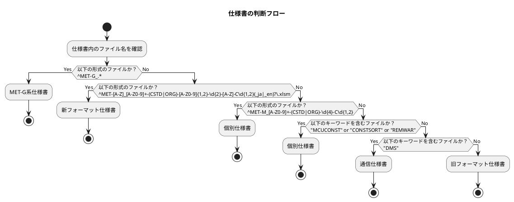

# 仕様書の種類の判断方法と仕様書の読み方

## 仕様書の種類の判断方法
- 以下の"仕様書の判断フロー"に従い、分析対象仕様書の種類を特定すること。
- 仕様書ファイル毎に仕様書の種類を特定すること。

## 仕様書の読み方referenceの参照方法
- 仕様書の種類の判断結果に応じ、仕様書分析に必要な仕様書の読み方のreferenceを参照すること。
  参照するreferenceは下表に従い選択すること。
  | 仕様書種類 | 参照reference |
  |---|---|
  | 全種類の仕様書 | [reference/concepts-spec-common-rules.md](reference/concepts-spec-common-rules.md) [reference/concepts-spec-glossary.md](reference/concepts-spec-glossary.md) |
  | MET-G系仕様書 | [reference/guide-graphic-spec.md](reference/guide-graphic-spec.md) |
  | 新フォーマット仕様書 | [reference/guide-newformat-sheetsection.md](reference/guide-newformat-sheetsection.md) [reference/guide-newformat-item.md](reference/guide-newformat-item.md) [reference/guide-newformat-invalid.md](reference/guide-newformat-invalid.md) |
  | 個別仕様書 | [reference/guide-list-spec.md](reference/guide-list-spec.md) |
  | 通信仕様書 | [reference/guide-comspec.md](reference/guide-comspec.md) |
  | 旧フォーマット仕様書 | [reference/guide-oldformat.md](reference/guide-oldformat.md) |
