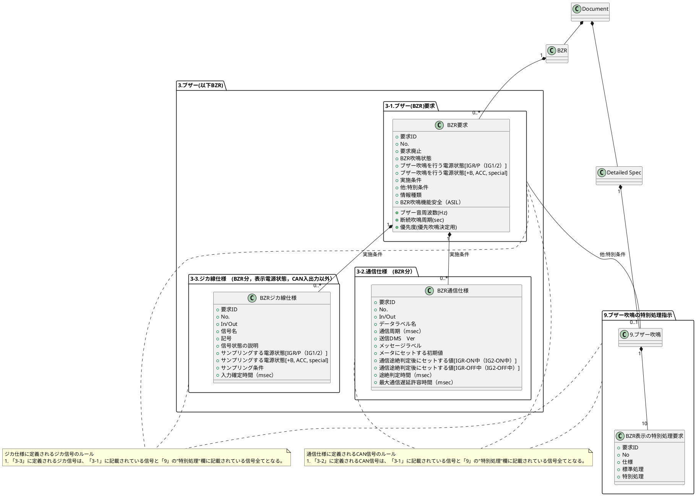
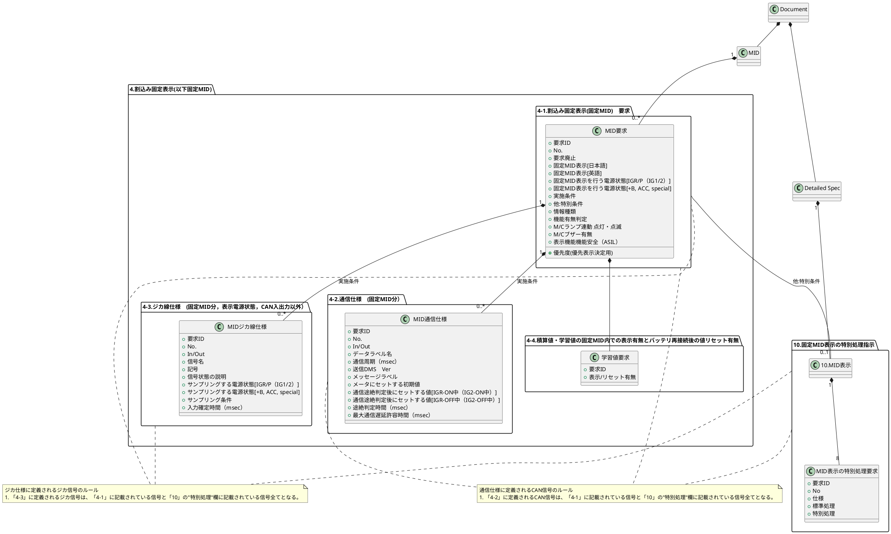
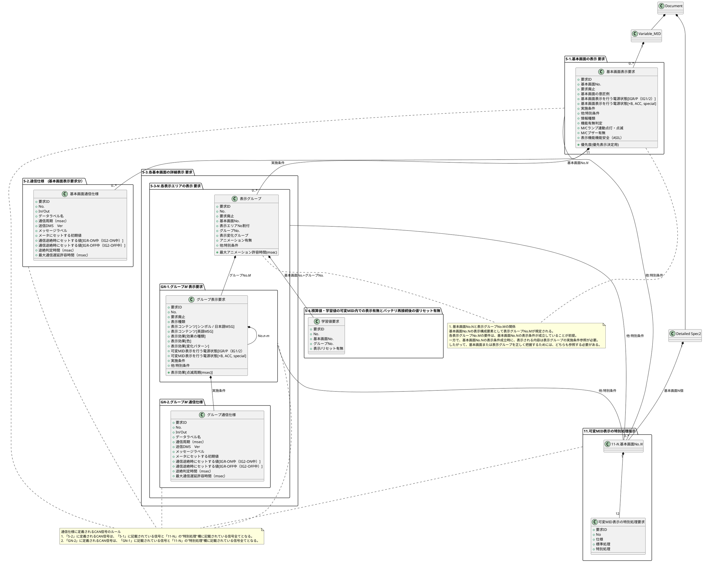
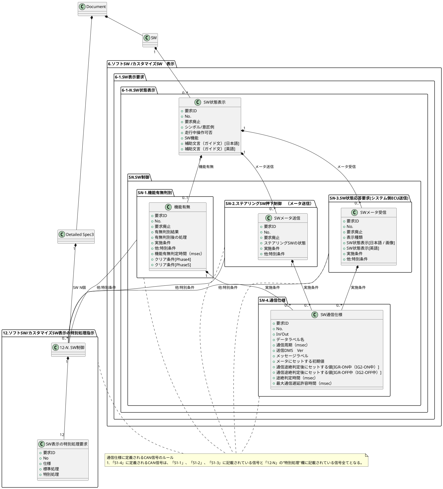

# TT, Detailed Specシートを含むファイルの文書内関係:
ファイル内の要件は下記依存関係にある。
TTまたはDetailed Specのシートの内容を解釈する場合は、下記依存関係に基づき関連情報の取得と解釈を行うこと。

```plantuml
@startuml
class TT
    package "2.テルテール(以下TT，インジケータと同義)" as 2 {
        package "2-<I>N</I>-1.シンボル" as 2n1 {
            class "シンボル" as symbol {
                + 要求ID
                + シンボル
                + 色
                + MID有り時のTT設定要否
                + 左記の設定必要な理由
            }
        }
        package "2-<I>N</I>-2.TT要求" as 2n2 {
            class "TT要求" as tt {
                + 要求ID
                + No.
                + 要求廃止
                + TT表示状態
                + 点滅周期（msec）
                + TT表示を行う電源状態[IGR/P（IG1/2）]
                + TT表示を行う電源状態[+B, ACC, special]
                + 実施条件
                + 他:特別条件
                + 機能有無判定
                + 表示機能機能安全（ASIL）
            }
        }
        package "2-<I>N</I>-3.通信仕様　(TT分）" as 2n3 {
            class "TT通信仕様" as tt_sig {
                + 要求ID
                + No.
                + In/Out
                + データラベル名
                + 通信周期（msec）
                + 送信DMS　Ver
                + メッセージラベル
                + メータにセットする初期値
                + 通信途絶判定後にセットする値[IGR-ON中（IG2-ON中）]
                + 通信途絶判定後にセットする値[IGR-OFF中（IG2-OFF中）]
                + 途絶判定時間（msec）
                + 最大通信遅延許容時間（msec）
            }
        }
        package "2-<I>N</I>-4.ジカ線仕様　(TT分，表示電源状態，CAN入出力以外）" as 2n4 {
            class "TTジカ線仕様" as tt_line {
                + 要求ID
                + No.
                + In/Out
                + 信号名
                + 記号
                + 信号状態の説明
                + サンプリングする電源状態[IGR/P（IG1/2）]
                + サンプリングする電源状態[+B, ACC, special]
                + サンプリング条件
                + 入力確定時間（msec）
            }
        }
    }
    package "2-A.メンテナンス・点検　警告灯" as 2a {
        package "2-A-1.シンボル" as 2a1 {
            class "シンボル" as 2a_symbol {
                + 要求ID
                + シンボル
                + 色
            }
        }
        package "2-A-2.TT要求" as 2a2 {
            class "TT要求" as 2a_tt {
                + 要求ID
                + No.
                + 要求廃止
                + TT表示状態
                + 点滅周期（msec）
                + TT表示を行う電源状態[IGR/P（IG1/2）]
                + TT表示を行う電源状態[+B, ACC, special]
                + 実施条件
                + 他:特別条件
                + 機能有無判定
                + 表示機能機能安全（ASIL）
            }
        }
        package "2-A-3.通信仕様　(TT分）" as 2a3 {
            class "TT通信仕様" as 2a_tt_sig {
                + 要求ID
                + No.
                + In/Out
                + データラベル名
                + 通信周期（msec）
                + 送信DMS　Ver
                + メッセージラベル
                + メータにセットする初期値
                + 通信途絶判定後にセットする値[IGR-ON中（IG2-ON中）]
                + 通信途絶判定後にセットする値[IGR-OFF中（IG2-OFF中）]
                + 途絶判定時間（msec）
                + 最大通信遅延許容時間（msec）
            }
        }
        package "2-A-4.ジカ線仕様　(TT分，表示電源状態，CAN入出力以外）" as 2a4 {
            class "TTジカ線仕様" as 2a_tt_line {
                + 要求ID
                + No.
                + In/Out
                + 信号名
                + 記号
                + 信号状態の説明
                + サンプリングする電源状態[IGR/P（IG1/2）]
                + サンプリングする電源状態[+B, ACC, special]
                + サンプリング条件
                + 入力確定時間（msec）
            }
        }
    }
    package "2-B.停車警告灯" as 2b {
        package "2-B-1.シンボル" as 2b1 {
            class "シンボル" as 2b_symbol {
                + 要求ID
                + シンボル
                + 色
            }
        }
        package "2-B-2.TT要求" as 2b2 {
            class "TT要求" as 2b_tt {
                + 要求ID
                + No.
                + 要求廃止
                + TT表示状態
                + 点滅周期（msec）
                + TT表示を行う電源状態[IGR/P（IG1/2）]
                + TT表示を行う電源状態[+B, ACC, special]
                + 実施条件
                + 他:特別条件
                + 機能有無判定
                + 表示機能機能安全（ASIL）
            }
        }
        package "2-B-3.通信仕様　(TT分）" as 2b3 {
            class "TT通信仕様" as 2b_tt_sig {
                + 要求ID
                + No.
                + In/Out
                + データラベル名
                + 通信周期（msec）
                + 送信DMS　Ver
                + メッセージラベル
                + メータにセットする初期値
                + 通信途絶判定後にセットする値[IGR-ON中（IG2-ON中）]
                + 通信途絶判定後にセットする値[IGR-OFF中（IG2-OFF中）]
                + 途絶判定時間（msec）
                + 最大通信遅延許容時間（msec）
            }
        }
        package "2-B-4.ジカ線仕様　(TT分，表示電源状態，CAN入出力以外）" as 2b4 {
            class "TTジカ線仕様" as 2b_tt_line {
                + 要求ID
                + No.
                + In/Out
                + 信号名
                + 記号
                + 信号状態の説明
                + サンプリングする電源状態[IGR/P（IG1/2）]
                + サンプリングする電源状態[+B, ACC, special]
                + サンプリング条件
                + 入力確定時間（msec）
            }
        }
    }

Document *-- TT
TT "1" *-- "0..*" symbol
TT "1" *-- "0..1" 2a_symbol
TT "1" *-- "0..1" 2b_symbol
symbol "1" *-- "2..*" tt
2a_symbol "1" *-- "2..*" 2a_tt
2b_symbol "1" *-- "2..*" 2b_tt
tt "1" *-- "0..*" tt_sig: 実施条件
2a_tt "1" *-- "0..*" 2a_tt_sig: 実施条件
2b_tt "1" *-- "0..*" 2b_tt_sig: 実施条件
tt "1" *-- "0..*" tt_line: 実施条件
2a_tt "1" *-- "0..*" 2a_tt_line: 実施条件
2b_tt "1" *-- "0..*" 2b_tt_line: 実施条件

class "Detailed Spec" as dtel
package "8.TT表示の特別処理指示" as 8 {
    class "8-<I>N</I>.TT表示" as 8-N
    class "TT表示の特別処理要求" as ttdetl {
        + 要求ID
        + No
        + 仕様
        + 標準処理
        + 特別処理
    }
    class "8-A.TT表示 (メンテナンス・点検　警告灯)" as 8-A
    class "TT表示の特別処理要求" as ttdetl_A {
        + 要求ID
        + No
        + 仕様
        + 標準処理
        + 特別処理
    }
    class "8-B.TT表示 (停車警告灯)" as 8-B
    class "TT表示の特別処理要求" as ttdetl_B {
        + 要求ID
        + No
        + 仕様
        + 標準処理
        + 特別処理
    }
}

Document *-- dtel
dtel "1" *-- "0..*" "8-N": TT N個
"8-N" "1" *-- "11" ttdetl
dtel "1" *-- "0..1" "8-A": TT (メンテナンス・点検　警告灯)
"8-A" "1" *-- "8" ttdetl_A
dtel "1" *-- "0..1" "8-B": TT (停車警告灯)
"8-B" "1" *-- "8" ttdetl_B

2n2 -- "8-N": 他:特別条件
2a2 -- "8-A": 他:特別条件
2b2 -- "8-B": 他:特別条件

note as detailedrelation1 
通信仕様に定義されるCAN信号のルール  
# 「2-N-3」に定義されるCAN信号は、「2-N-2」に記載されている信号と「8-N」の"特別処理"欄に記載されている信号全てとなる。  
# 「2-A-3」に定義されるCAN信号は、「2-A-2」に記載されている信号と「8-A」の"特別処理"欄に記載されている信号全てとなる。  
# 「2-B-3」に定義されるCAN信号は、「2-B-2」に記載されている信号と「8-B」の"特別処理"欄に記載されている信号全てとなる。
end note  
2n2 .. detailedrelation1  
2a2 .. detailedrelation1  
2b2 .. detailedrelation1
2n3 .. detailedrelation1  
2a3 .. detailedrelation1  
2b3 .. detailedrelation1  
"8" .. detailedrelation1

note as detailedrelation2 
ジカ仕様に定義されるジカ信号のルール  
# 「2-N-4」に定義されるジカ信号は、「2-N-2」に記載されている信号と「8-N」の"特別処理"欄に記載されている信号全てとなる。 
# 「2-A-4」に定義されるジカ信号は、「2-A-2」に記載されている信号と「8-A」の"特別処理"欄に記載されている信号全てとなる。 
# 「2-B-4」に定義されるジカ信号は、「2-B-2」に記載されている信号と「8-B」の"特別処理"欄に記載されている信号全てとなる。
end note 
2n2 .. detailedrelation2 
2a2 .. detailedrelation2  
2b2 .. detailedrelation2
2n4 .. detailedrelation2  
2a4 .. detailedrelation2  
2b4 .. detailedrelation2  
"8" .. detailedrelation2

@enduml
```

### BZR, Detailed Specシートを含むファイルの文書内関係:
ファイル内の要件は下記依存関係にある。
BZRまたはDetailed Specのシートの内容を解釈する場合は、下記依存関係に基づき関連情報の取得と解釈を行うこと。

### MID, Detailed Specシートを含むファイルの文書内関係:
ファイル内の要件は下記依存関係にある。
MIDまたはDetailed Specのシートの内容を解釈する場合は、下記依存関係に基づき関連情報の取得と解釈を行うこと。

### Variable_MID, Detailed Spec2シートを含むファイルの文書内関係:
ファイル内の要件は下記依存関係にある。
Variable_MIDまたはDetailed Spec2のシートの内容を解釈する場合は、下記依存関係に基づき関連情報の取得と解釈を行うこと。

### SW, Detailed Spec3シートを含むファイルの文書内関係:
ファイル内の要件は下記依存関係にある。
SWまたはDetailed Spec3のシートの内容を解釈する場合は、下記依存関係に基づき関連情報の取得と解釈を行うこと。

