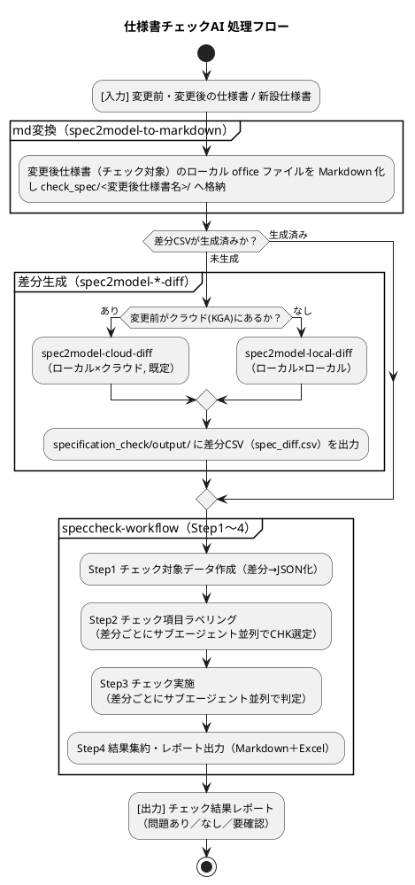

# 本書について（仕様書チェックAI 開発者向け）

- 最終更新：2026-08-06

本書は、仕様書チェックAIを構成する各 SKILL（general-rule / meter-spec-common / speccheck-workflow / spec2model-cloud-diff / spec2model-local-diff / spec2model-to-markdown）の**全体像・役割・関係・内部構成**を一つにまとめた開発者向け説明書である。
仕様書チェックAIの**概要**と**使い方（前提・準備・入力プロンプト例）** は、ユーザー向けドキュメント [仕様書チェックAI_ユーザーガイド.md](仕様書チェックAI_ユーザーガイド.md) を参照すること。
個々の SKILL の詳細は各スキルの `SKILL.md` を参照すること。

---

## 目次

- [本書について（仕様書チェックAI 開発者向け）](#本書について仕様書チェックai-開発者向け)
  - [目次](#目次)
  - [1. スキル構成（6つのSKILL）](#1-スキル構成6つのskill)
  - [2. 仕様書チェックAIの処理フロー](#2-仕様書チェックaiの処理フロー)
    - [2.1 スキル読み込み順（システムプロンプト規定）](#21-スキル読み込み順システムプロンプト規定)
    - [2.2 全体フロー（入力準備 → チェック実行）](#22-全体フロー入力準備--チェック実行)
    - [2.3 入力パターンと差分の扱い（Step1）](#23-入力パターンと差分の扱いstep1)
  - [3. 各 SKILLS の役割と概要](#3-各-skills-の役割と概要)
    - [差分スキルの使い分け（重要）](#差分スキルの使い分け重要)
  - [4. 各 SKILLS の詳細説明](#4-各-skills-の詳細説明)
    - [4.1 general-rule（基本ルール）](#41-general-rule基本ルール)
    - [4.2 meter-spec-common（種類判定・読み方ガイド）](#42-meter-spec-common種類判定読み方ガイド)
    - [4.3 spec2model-cloud-diff / spec2model-local-diff（差分生成）](#43-spec2model-cloud-diff--spec2model-local-diff差分生成)
    - [4.4 speccheck-workflow（チェック本体）](#44-speccheck-workflowチェック本体)
    - [4.5 spec2model-to-markdown（md変換）](#45-spec2model-to-markdownmd変換)
  - [5. スクリプト一覧（speccheck-workflow）](#5-スクリプト一覧speccheck-workflow)
  - [6. spec2model 更新時の処置(★bitbucket登録者向け)](#6-spec2model-更新時の処置bitbucket登録者向け)
    - [6.1 更新反映の手順](#61-更新反映の手順)
  - [7. 関連ドキュメント](#7-関連ドキュメント)

---

## 1. スキル構成（6つのSKILL）

仕様書チェックAIは、客先からDR依頼のあった正式発効前のメータ仕様書について、チェック項目（CHK-*）に従い内容の不備・不足や他仕様書への影響を確認し、問題を検出してレポートするAIエージェントである（機能概要は [仕様書チェックAI_ユーザーガイド.md](仕様書チェックAI_ユーザーガイド.md) を参照）。

これらの振る舞いは、6つの SKILL を**役割分担**して実現する。

| 区分 | SKILL | 概要 |
|---|---|---|
| 土台（共通ルール） | general-rule | 分析全体を貫く基本ルール・行動規範・探索フロー |
| 土台（仕様書の読み方ルール） | meter-spec-common | 仕様書の種類を判定し、種類別に仕様書の読み方を定義 |
| 前処理（md変換） | spec2model-to-markdown | 変更後仕様書（チェック対象仕様書）のローカル office ファイルを Markdown 化し `check_spec/<変更後仕様書名>/` へ格納（Step1が呼び出す） |
| 前処理（差分生成） | spec2model-cloud-diff | ローカルに格納された仕様書 × KGAに登録された仕様書の差分CSVを生成 |
| 前処理（差分生成(サブ)） | spec2model-local-diff | ローカルに格納された仕様書間 の差分CSVを生成(KGAに変更前仕様書が格納されておらず、spec2-model-cloud-diffが使用できないときに適用) |
| 本処理（チェック） | speccheck-workflow | 差分に対しチェック項目を適用し、レポート出力 |

---

## 2. 仕様書チェックAIの処理フロー

### 2.1 スキル読み込み順（システムプロンプト規定）

仕様書チェック時は、以下の順序でスキルを読み込む（`CLAUDE.md` 規定）。

1. `general-rule/SKILL.md` を読み込む（基本ルール）。
2. `meter-spec-common/SKILL.md` を読み込み、入力された各仕様書ファイルに対し必要な reference を読み込む（種類判定＋読み方）。
3. `speccheck-workflow/SKILL.md` を読み込む（チェック手順）。

### 2.2 全体フロー（入力準備 → チェック実行）



なお、上図にステップとして現れない土台スキル（general-rule / meter-spec-common）は、フロー全体を通して次のように効いている。

- **種類判定・読み方（meter-spec-common）** は、Step1 の入力変換（フォーマット別スクリプトの選択）や Step2 のチェック項目選定の根拠として全体を通して利用される。
- **基本ルール（general-rule）** は、上記すべての工程（特に KGA 探索・根拠提示・応答形式）に適用される。

### 2.3 入力パターンと差分の扱い（Step1）

いずれの入力パターンでも、Step1 は最初に**変更後仕様書（チェック対象仕様書）のローカル office ファイルを spec2model-to-markdown で Markdown 化**し、`check_spec/<変更後仕様書名>/` へ格納する（変換対象は変更後仕様書のみ。差分CSVの用意手順には影響しない）。そのうえで、下表のとおり差分レコード列を作成する。

| 入力パターン | 差分の作り方 | 使用スキル／スクリプト |
|---|---|---|
| 変更前・変更後あり（差分CSVあり） | 差分CSVをJSON化 | `csv_to_diff_json.py` |
| 変更前・変更後あり（差分CSV未生成） | 差分CSVを生成後にJSON化 | spec2model-cloud-diff（既定）／spec2model-local-diff |
| 変更前なし（新設仕様書） | 本体mdの全内容を「追加」相当に変換 | 新フォーマット本体: `newformat_md_to_newspec_json.py`／旧フォーマット本体・添付資料: `oldformat_md_to_newspec_json.py`<br>（本体+添付混在時は両者を同一JSONへ結合） |
| ファイル追加（変更後にAppendixなどの新規ファイルあり時） | 追加ファイルのmdを「追加」相当のレコードJSONへ変換し、既存ファイルの差分JSONと結合 | 上記 + `oldformat_md_to_newspec_json.py --append` |

> DMSファイル（ファイル名に "DMS" を含む）は変換対象から除外する。
>
> 仕様書チェックでは、変更後仕様書は前準備で `check_spec/` に格納されるためローカル文書として扱われ、変更前仕様書は既定でクラウド（KGA）として扱われる（KGAに無い場合のみ変更前もローカルとし spec2model-local-diff を用いる）。
>
> **【入力の制約】旧バイナリ `.doc` / `.xls` は使用せず `.docx` / `.xlsx` へ変換して格納する（変更前・変更後の双方）。** `spec2model` は `.doc`（`parse_docx`）／`.xls`（`parse_excel`）を内部で `libreoffice` により `.docx`／`.xlsx` へ変換してから解析するが、標準環境では `libreoffice` が PATH 未解決のため `WinError 2` で失敗する（`.xls` には未使用の `xlrd` 経路も存在するが解析経路からは呼ばれない）。`.xlsx/.xlsm/.docx/.pptx` は LibreOffice 非依存でそのまま利用可。

---

## 3. 各 SKILLS の役割と概要

| SKILL | 役割 | 主な入力 | 主な出力／成果 | 呼び出し関係 |
|---|---|---|---|---|
| **general-rule** | 仕様書分析全体の基本ルール（KGA探索の制約・行動規範・応答要件）を定義。他スキルの土台。 | ―（常時適用） | 探索フロー・根拠提示・応答形式の規範 | 最初に読み込む前提 |
| **meter-spec-common** | 仕様書の種類（MET-G系／新フォーマット／個別／通信／旧フォーマット）を判定し、種類別の読み方（reference）を案内。 | 仕様書ファイル名 | 種類判定結果、参照すべき reference | 仕様書種類の判定結果を speccheck-workflowのStep1,2が利用する。また、Step3のチェック実施時にもサブエージェントが仕様書に応じて参照する。 |
| **spec2model-to-markdown** | 変更後仕様書（チェック対象）のローカル office 文書を Markdown に変換。 | ローカル office 文書（`.xlsx/.xlsm/.xls/.docx/.doc/.pptx`） | md（＋画像）→ `check_spec/<変更後仕様書名>/` | speccheck-workflow Step1 が呼び出し、新設・ファイル追加のJSON化やStep3の参照先に用いるmdを用意 |
| **spec2model-cloud-diff** | （既定）ローカル1件 × KGAクラウド1件 の構造化差分を生成。 | ローカル文書1件＋クラウド文書1件 | 差分CSV（必要に応じHTML）→ `data/output_data/` | speccheck-workflow Step1 の入力を用意 |
| **spec2model-local-diff** | （サブ）ローカル2件 の構造化差分を生成。KGAに変更前仕様書が無く spec2model-cloud-diff が使えない場合に使用。 | ローカル文書2件 | 差分CSV（必要に応じHTML）→ `data/output_data/` | spec2model-cloud-diff のフォールバック。speccheck-workflow Step1 の入力を用意 |
| **speccheck-workflow** | 差分に対しチェック項目を選定・実施し、問題を検出してレポート。 | 差分CSV／仕様書本体md | チェック結果レポート（Markdown＋Excel） | diffスキルが生成した差分CSVを入力に使用し、meter-spec-common の判定結果を Step1,2 で利用する |

### 差分スキルの使い分け（重要）

差分スキル**汎用**のローカル／クラウド判定は次のとおり。

- **ローカルパスまたは添付ファイル**があるものだけを「ローカル文書」として扱う。
- **ファイル名だけ**が与えられたものは常に「クラウド文書（KGA）」として扱う。

| 比較対象 | 使用するもの |
|---|---|
| ローカル1件 × クラウド1件 | **spec2model-cloud-diff** |
| ローカル2件 | **spec2model-local-diff** |
| クラウド2件（ファイル名のみ2件） | スキルではなく `graph_diff_documents` MCP ツールを直接使用 |

なお**仕様書チェックでの運用**では、上記の判定は役割で固定される。変更後仕様書は前準備で `check_spec/` に格納されるためローカル文書として扱われ、変更前仕様書は既定でクラウド（KGA）として扱われる（＝ spec2model-cloud-diff が既定。KGAに変更前が無い場合のみ変更前もローカルとし spec2model-local-diff を用いる）。

---

## 4. 各 SKILLS の詳細説明

各スキルの詳細（内部手順・ファイル）は個別の `SKILL.md` に規定されている。

### 4.1 general-rule（基本ルール）

仕様書分析（仕様書チェック・要件定義）を行うすべての場合に**最初に読み込む**基本ルール。KGA を探索する読取専用エージェントとしての制約・行動規則・応答要件をまとめ、他スキルの土台となる。

- **制約・原則**：根拠必須、環境文脈の尊重、逐次実行（並列ツール呼び出し無効）、サイズ上限遵守。
- **行動規則**：表現規範（便宜表現には正式用語を括弧書き併記＋末尾に読み替え一覧）、網羅的調査の徹底、明示／暗黙参照ドキュメントの必読ルール（曖昧参照先の段階的解決手順を含む）、巨大表・長文対策、UI（表示物）からの影響範囲分析、`@参照` あり／なしの探索フロー、固有ラベル名（信号・定数・フレーム等）の検索フロー。
- **固有知識**：【】囲み文字列＝定数名の可能性、信号／定数／フレーム名の扱い。
- **禁止事項・フェイルソフト規則**：ファイル名の直接検索禁止、第1パス省略禁止、未解決時の早期終了など。
- **応答要件**：エビデンスのフルネーム出力・ノードID併記・抜粋の扱い、`/INFERENCE_LOG` 系の調査プロセス出力。

→ 詳細：[general-rule/SKILL.md](general-rule/SKILL.md)

### 4.2 meter-spec-common（種類判定・読み方ガイド）

分析対象の仕様書が**どの種類か**を判定し、種類に応じた**読み方（reference）**を案内する。仕様書分析を実施する場合は必ず利用する。

- **判定フロー**（`SKILL.md`）：ファイル名の形式から、MET-G系 / 新フォーマット / 個別仕様書 / 通信仕様書 / 旧フォーマット の5種を**ファイル単位**で判定。
- **参照表**：判定結果に応じて読み込む reference を対応表で規定。全種類共通の2ファイル（仕様書共通ルール／仕様書専門用語）は必ず参照。
- **reference/**：種類別の読み方ガイド（共通ルール・専門用語、MET-G系、個別仕様書（一覧系）、通信仕様書、旧フォーマット、新フォーマット専用の3ファイル）。

判定結果は speccheck-workflow の Step1（入力変換スクリプトの選択）・Step2（チェック項目選定）で活用される。
さらに、Step3（チェック実施）でも各サブエージェントが、対象仕様書のフォーマット種別（meter-spec-common で確定）に応じた読み方ガイド・全種類共通reference（用語／共通ルール）を参照して判定する。

→ 詳細：[meter-spec-common/SKILL.md](meter-spec-common/SKILL.md)

### 4.3 spec2model-cloud-diff / spec2model-local-diff（差分生成）

仕様書チェックの入力となる**構造化差分（CSV／必要に応じHTML）**を生成する前処理スキル。`tools/spec2model` を用いて比較を実行する。出力先はスキル単体実行時の既定が `data/output_data/` だが、**仕様書チェック実行時は speccheck-workflow が `--out-csv` / `--out-html` で `specification_check/output/spec_diff.csv`（／`spec_diff.html`）へ固定出力する**（[step1_prep_checkdata.md](speccheck-workflow/steps/step1_prep_checkdata.md) の「出力名・出力場所の固定（MUST）」）。

- **spec2model-cloud-diff（既定）**：ローカルの Office/PDF（`.xlsx/.xlsm/.xls/.docx/.pptx/.pdf`）1件と、KGA クラウド文書1件を比較。KGA MCP でクラウド文書の構造化データをエクスポートして比較。仕様書チェックAIにおいて、差分生成は原則こちらを用いる。
- **spec2model-local-diff（サブ）**：アクセス可能なローカル文書2件を比較。両入力がファイル名のみ（添付・ローカルパスなし）の場合はクラウド扱いとし、本スキルではなく `graph_diff_documents` を使用する。仕様書チェックAIにおいては、**KGA に変更前仕様書が無く spec2model-cloud-diff が使えない場合のフォールバック**として用いる。

→ 詳細：[spec2model-cloud-diff/SKILL.md](spec2model-cloud-diff/SKILL.md) ／ [spec2model-local-diff/SKILL.md](spec2model-local-diff/SKILL.md)

### 4.4 speccheck-workflow（チェック本体）

正式発効前の仕様書について、チェック項目に従い**内容の不備不足や他仕様書への影響**を確認し、問題を検出してレポートする。

**Step1〜4の流れ：**

```text
Step1 チェック対象データ作成 ─▶ Step2 チェック項目ラベリング ─▶ Step3 チェック実施 ─▶ Step4 結果集約・レポート出力
（Step2・Step3 はいずれも 1差分＝1サブエージェント並列で実行）
```

- **Step1（チェック対象データ作成）**：まず変更後仕様書（チェック対象）のローカル office ファイルを spec2model-to-markdown で Markdown 化し `check_spec/<変更後仕様書名>/` へ格納。そのうえで、通常は差分CSVを、新設・ファイル追加時は仕様書本体mdを入力に、差分JSONへ変換。
- **Step2（チェック項目ラベリング）**：各差分レコードに適用すべきチェック項目（`checkno`）を、1差分＝1サブエージェント並列で付与。仕様書名判定により選定条件ファイル（標準制御仕様書：`std_ctrl_check_selection.md` /標準GFX仕様書： `metg_check_selection.md`）を分岐。
- **Step3（チェック実施）**：チェック項目ラベリング済み各差分に対しサブエージェントでチェックを実行し、各チェック項目について**問題あり／なし／要確認**を判定して結果JSONを出力。
- **Step4（レポート出力）**：結果JSON群を集約し、最終レポート（Markdown＋Excel）を生成。

**チェック項目（CHK-*）**：
- `check/`：チェック対象仕様書がGFX仕様書以外(仕様書名に`MET-G` を含まない通常仕様書の場合)に使用する（実施要否は `std_ctrl_check_selection.md` で判定）。
- `MET-G_check/`：チェック対象仕様書がGFX仕様書の場合(仕様書名に`MET-G` を含む場合)に使用する。（実施要否は `metg_check_selection.md` で判定）。

**実行環境の注意**：同梱pythonスクリプトは `PowerShell(python:*)` allow 設定下で承認プロンプトなく実行できるよう、`dangerouslyDisableSandbox` を使わず、コマンドは連結せず1つずつ実行する。ファイル一覧確認は原則 Glob を用いる。

→ 詳細：[speccheck-workflow/SKILL.md](speccheck-workflow/SKILL.md)（各Stepの詳細・CHK項目・scripts仕様を含む）

### 4.5 spec2model-to-markdown（md変換）

変更後仕様書（チェック対象仕様書）のローカル Office 文書を `tools/spec2model` で解析し **Markdown へ変換**する前処理スキル。speccheck-workflow の Step1「手順（変更後仕様書のマークダウン変換）」から呼び出され、`check_spec/<変更後仕様書名>/` 配下へ md（＋画像）を出力する。

- **対象**：`check_spec/<変更後仕様書名>/` フォルダ内の対応 office ファイル（`.xlsx/.xlsm/.xls/.docx/.doc/.pptx`）を**すべて**変換する（**変更後仕様書のみ**。変更前仕様書は変換しない）。DMS等の下流での除外は Step1 のJSON化手順が担う。
- **出力先の固定**：speccheck-workflow から呼び出す際は `--output-dir "specification_check/check_spec/<変更後仕様書名>"` を明示し、変換元と同じフォルダへ格納する（画像は同フォルダ配下 `images/`）。
- **実行基盤**：差分スキルと同じ `tools/spec2model/.venv` の venv python を使用する（追加のセットアップは不要）。

→ 詳細：[spec2model-to-markdown/SKILL.md](spec2model-to-markdown/SKILL.md)

---

## 5. スクリプト一覧（speccheck-workflow）

speccheck-workflow の各Stepで用いる Python スクリプト（`skills/speccheck-workflow/scripts/`）。実行はプロジェクトの `.claude` を起点とし（`cd` 不要）、スクリプトパス・入出力パスは `.claude` からの相対で指定する（`settings.json` の許可 `PowerShell(python:*)` と整合）。詳細な仕様・オプションはスクリプト冒頭のdocstringを参照。

| Step | スクリプト | 役割 | 主な入力 → 出力 | 依存 |
|---|---|---|---|---|
| Step1 | `csv_to_diff_json.py` | 差分CSVを8キーの差分JSONへ変換 | `data/output_data/*.csv` → `output/*_diff.json` | 標準ライブラリ |
| Step1 | `newformat_md_to_newspec_json.py` | 新設の新フォーマットのmdを「追加」相当のレコードJSONへ変換（DMS・添付資料は自動除外） | `check_spec/<仕様書名>/` → `output/<仕様書名>_newspec.json` | 標準ライブラリ |
| Step1 | `oldformat_md_to_newspec_json.py` | 新設の旧フォーマット本体・添付資料のmdを章節単位レコードJSONへ変換（`--attachment-only`／`--append` で本体JSONへ結合） | `check_spec/<仕様書名>/` → `output/<仕様書名>_newspec.json` | 標準ライブラリ |
| Step2 | `mark_invalid_items.py` | 新フォーマット仕様書について、`guide-newformat-invalid.md`に従いnewspec.json の各レコードへ「無視すべき列名」の配列 `invalid_items` を機械的に付与する。 サブエージェントはStep2ラベリングで`invalid_items`が付与された箇所を該当判定の根拠にしない。 | `output/<仕様書名>_newspec.json`（上書き） | 標準ライブラリ |
| Step2 | `checkno_split_merge.py` | Step2ラベリングを「1差分＝1サブエージェント」で行うための分割（split）と統合（merge）。`split`＝Step1出力の差分JSON（多数レコードの1配列）を1レコードずつのファイルに分割し各サブエージェントへ配布、`merge`＝各サブエージェントが付与したチェック項目（`checkno`）を集約して元の1本のJSONに書き戻す | Step1出力JSON ⇄ `output/<name>_records/` | 標準ライブラリ |
| Step3→4 | `merge_results_to_report.py` | Step3のサブエージェントのチェック結果JSON群を集約し Markdown レポートを生成 | `output/<仕様書名>_check_results/res_*.json` → `output/<仕様書名>_report.md` | 標準ライブラリ |
| Step4 | `report_md_to_xlsx.py` | Markdown レポートの結果テーブルを Excel へ変換 | `output/<仕様書名>_report.md` → `output/<仕様書名>_report.xlsx` | openpyxl |

> - `csv_to_diff_json.py`の8キーとは、差分レコードを表す次の8項目。変更前3項目（`file_old` / `sheet_old` / `chapter_old`）＋変更後3項目（`file_new` / `sheet_new` / `chapter_new`）＋本文2項目（`before_markdown`＝変更前原文 / `after_markdown`＝変更後原文）。`newformat_/oldformat_md_to_newspec_json.py` の出力もこの8キーに互換（新設は `before_markdown=""`）。
> - `report_md_to_xlsx.py` は `openpyxl` 依存のため、未導入時に `pip install openpyxl` が必要。
> - 差分生成スキル（spec2model-cloud-diff／spec2model-local-diff）のスクリプトは Step1 の前段で差分CSVを生成する（詳細は各スキルの `SKILL.md`）。
> - 変更後仕様書のmd変換は spec2model-to-markdown スキルの `scripts/export_to_markdown.py`（venv python 実行）を Step1 が呼び出して行う（出力先は `check_spec/<変更後仕様書名>/`）。

---

## 6. spec2model 更新時の処置(★bitbucket登録者向け)

差分生成スキル（spec2model-cloud-diff / spec2model-local-diff）が利用する差分生成エンジン `spec2model` を更新（バージョン更新・差し替え）する際に必要な付随作業をまとめる。本節は **メータ用 spec2model リポジトリ(bitbucket) にspec2modelを登録する担当者向け** である。

- **いつ実施するか**：`spec2model` を GitHub 側の更新に追従して更新し、メータ用 spec2model リポジトリ(bitbucket) に登録するとき。
- **なぜ必要か**：GitHub 版のコンフィグはデフォルト設定のままであり、KGA 側の設定やメータ専用設定と整合させないと、`spec2model-cloud-diff` の差分取得時に意図しない差分が多数出力される懸念があるため。
- **リポジトリ**：
  - spec2model（GitHub, 更新元）: [AI4SE-DEV/spec2model](https://github.com/AI4SE-DEV/spec2model)
  - メータ用 spec2model（bitbucket, 登録先）: [dev-dev1-tol-spec2model](https://aip01.dndev.net/bitbucket/projects/TMETSPECA/repos/dev-dev1-tol-spec2model/browse)

具体的な作業は次の「6.1 更新反映の手順」に従い、実施後にメータ用 spec2model リポジトリ(bitbucket) へ登録する。

### 6.1 更新反映の手順

1. `spec2model` が GitHub 側で更新された場合、KGA側のspec2modelにもGitHubに登録されている最新のspec2modelが反映されていることを技術企画部に確認すること。(spec2modelのバージョンずれがあると、`spec2model-cloud-diff`で差分取得実施した際に意図しない差分が出力される懸念あり)
2. `spec2model\config\diff_config.yaml`と`spec2model\config\parser_config.yaml`の変更内容を確認し、bitbucketに登録されている spec2model のyamlファイルに取り込む。また、上記ファイルにパラメータの追加があった場合は内容を技術企画部に確認し、必要に応じて設定値の書き換えを実施すること。
   - 補足：bitbucketに登録されている `diff_config.yaml` / `parser_config.yaml` は**メータ専用の設定値**にカスタマイズされている（参考：[コンフィグファイルのパラメータ設定（Wiki 5章）](https://aip01.dndev.net/wiki/pages/viewpage.action?pageId=318815641)）。一方、GitHub に登録される`spec2model\config`以下のファイルは**デフォルト設定**のため、GitHub 版をそのまま取り込むだけでは不十分で、メータ専用の設定値を反映（マージ）する必要がある。
3. `spec2model\config\diff_config.yaml`と`spec2model\config\parser_config.yaml`の設定値の書き換えを実施した場合は、KGA側のコンフィグ設定にも必ず反映すること(KGA側とローカル側の設定値にずれがあると、`spec2model-cloud-diff`で差分取得実施した際に意図しない差分が出力される懸念あり)
   - KGA側のコンフィグ設定へのアクセス方法：KGA画面の「管理」タブ →「コンフィグ」タブ を開き、`diff_config` / `parser_config` から設定できる。

---

## 7. 関連ドキュメント

- [仕様書チェックAI_ユーザーガイド.md](仕様書チェックAI_ユーザーガイド.md)（ユーザー向け・概要／使い方）
- 各スキルの `SKILL.md`（エージェントが実際に読み込む本体）
- `tools/spec2model/README.md`（差分生成エンジン）
